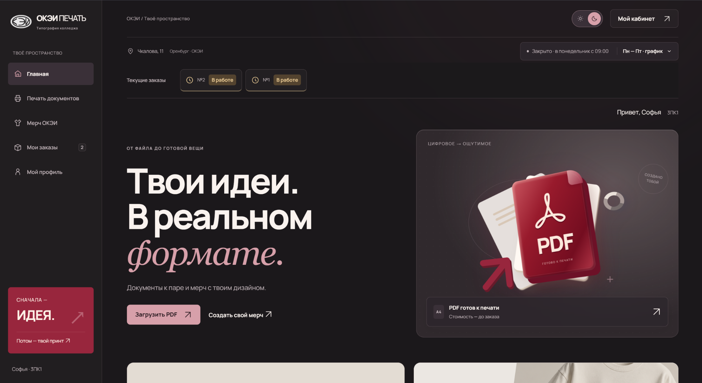
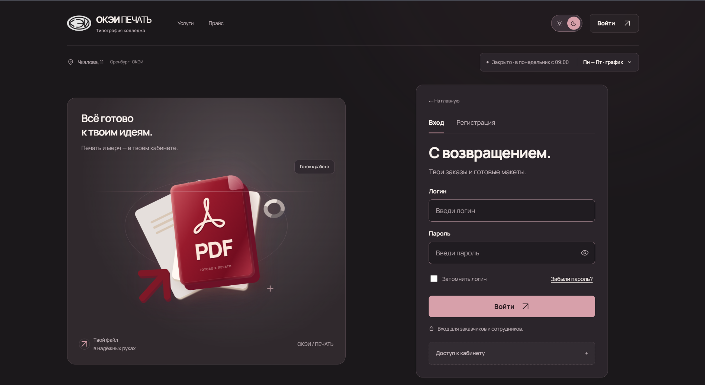
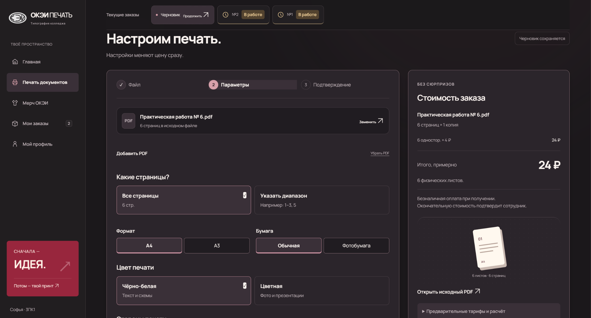
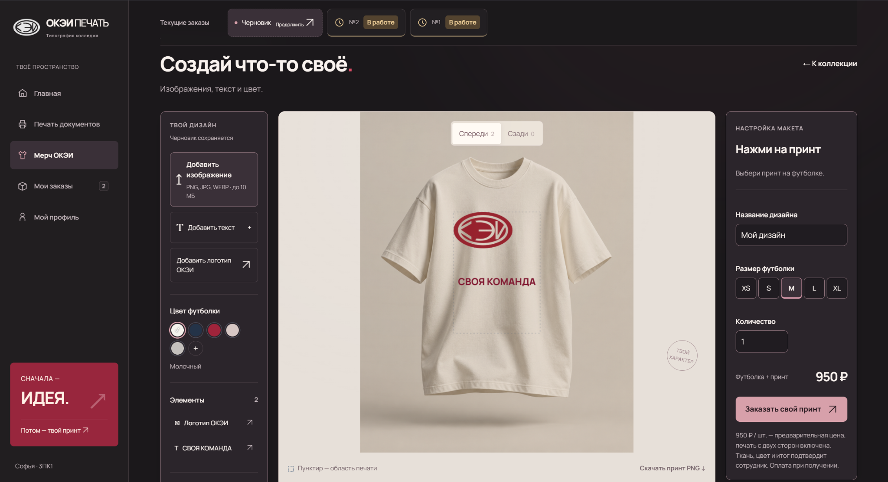
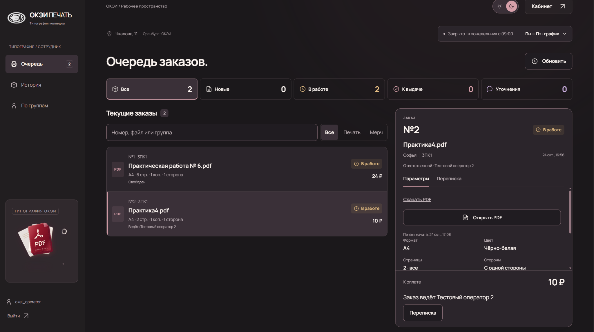

# ОКЭИ ПЕЧАТЬ

Система приёма и обработки заказов для типографии колледжа. Заказчики оформляют печать документов и мерч, сотрудники согласуют параметры и ведут заказы до выдачи, администратор управляет персоналом и действующим прайсом.



Кабинет заказчика с текущими заказами и переходами к печати документов и мерчу.

## Возможности

- **Заказчик:** регистрация, загрузка нескольких PDF, выбор параметров и расчёт стоимости, конструктор мерча, история заказов, переписка и отмена до начала изготовления.
- **Сотрудник:** общая очередь, назначение себя ответственным, проверка файлов и макетов, уточнения, производственные статусы, выдача с подтверждением оплаты и CSV-отчёт.
- **Администратор:** возможности сотрудника, управление доступом персонала, редактирование прайса и переназначение заказов. Изменение цен не пересчитывает оформленные заказы.

## Интерфейс

<details>
<summary>Авторизация</summary>



Вход в кабинет заказчика или сотрудника.

</details>

<details>
<summary>Оформление заказа</summary>



Выбор страниц и параметров печати с предварительным расчётом стоимости.

</details>

<details>
<summary>Конструктор мерча</summary>



Редактирование принта, выбор цвета футболки, размера и количества.

</details>

<details>
<summary>Кабинет сотрудника</summary>



Общая очередь с ответственными сотрудниками, статусами и параметрами заказа.

</details>

## Технологии

Frontend: HTML, CSS, JavaScript ES Modules и Canvas API, без сборщика. Backend: Node.js 24+, Express, SQLite через better-sqlite3; pdf-lib проверяет загруженные PDF, PDF.js используется в браузере. Запуск: Docker Compose; проверки: node:test, Playwright с Microsoft Edge, ESLint и Prettier.

Сторонние ресурсы: [PDF.js (Apache-2.0)](dist/assets/PDFJS-LICENSE), [Manrope (SIL OFL 1.1)](dist/assets/fonts/OFL.txt). Шрифты и PDF.js обслуживаются локально.

## Запуск

Требуются Docker Engine или Docker Desktop с Docker Compose v2. Выполните из корня репозитория:

```sh
docker compose up -d --build
docker compose ps
```

Приложение доступно по адресу http://127.0.0.1:8080. Compose по умолчанию настроен для локального HTTP. Дополнительные настройки задаются в приватном `.env` по образцу [.env.example](.env.example); существующий файл не перезаписывайте.

Первого администратора создайте служебной командой. Пример для PowerShell: пароль вводится скрыто, передаётся через окружение и не попадает в текст команды или историю оболочки.

```powershell
$env:ADMIN_LOGIN = Read-Host 'Логин администратора'
$env:ADMIN_NAME = Read-Host 'Имя администратора'
$adminSecret = Read-Host 'Пароль (8–256 символов)' -AsSecureString
try {
    $env:ADMIN_PASSWORD = [System.Net.NetworkCredential]::new('', $adminSecret).Password
    docker compose exec -e ADMIN_LOGIN -e ADMIN_PASSWORD -e ADMIN_NAME app npm run setup:admin
} finally {
    Remove-Item Env:ADMIN_PASSWORD, Env:ADMIN_LOGIN, Env:ADMIN_NAME -ErrorAction SilentlyContinue
    $adminSecret.Dispose()
}
```

Войдите через обычную форму входа; сотрудников добавляйте во вкладке «Сотрудники». Существующие аккаунты автоматически не повышаются до администратора.

Для разработки без Docker нужны Node.js 24+ и npm. Запускайте этот вариант вместо контейнера, использующего тот же порт:

```sh
npm ci
npm run start:server
```

Адрес тот же; настройки читаются из `.env`. Для создания администратора используйте блок PowerShell выше, заменив строку `docker compose exec ...` на `npm run setup:admin`. Команда должна использовать тот же `DATA_DIR`, что и сервер. `npm start` запускает отдельное демонстрационное приложение с данными браузера, без серверной базы.

## Структура проекта

```text
dist/           frontend, модули кабинетов, стили и локальные ресурсы
server/         HTTP API, авторизация, SQLite, заказы и служебные команды
scripts/        локальный HTTP-сервер демонстрационного режима
tests/          модульные, интеграционные и браузерные проверки
docs/           архитектура и снимки интерфейса
.vscode/        задача запуска демонстрационного режима
compose.yaml    сервис приложения и постоянные volumes
Dockerfile      контейнер Node.js с production-зависимостями
.env.example    образец настроек без секретов
```

Ответственность модулей и устройство API описаны в [документации архитектуры](docs/architecture.md).

## Тестирование

На машине с Node.js 24+ установите зависимости командой `npm ci`, затем выполните:

```sh
npm test
npm run test:regressions
npm run test:e2e
npm run lint
npm run format
```

Для Playwright требуется установленный Microsoft Edge и свободные порты 18087 и 18088. Тесты сами запускают серверы, используют временные базы и отдельные браузерные контексты. `npm run format` проверяет форматирование без записи файлов.

## Данные и резервное копирование

В Docker рабочие данные находятся в volume `data`: `/data/okei/okei.sqlite` и `/data/okei/pdf/`. Каталог `pdf/` содержит также JSON-макеты и PNG. Копии сохраняются в отдельный volume `backups`, каталог `/backups`. Без Docker по умолчанию используются каталоги `var/okei` и `var/backups`; пути задаются через `DATA_DIR` и `BACKUP_DIR`.

Перед обновлением создайте копию; команда проверяет SQLite и сохраняет вложения с контрольными суммами:

```sh
docker compose exec -T app npm run backup
docker compose up -d --build app
```

Для восстановления остановите сервис и выберите новый, несуществующий каталог. Замените `ИМЯ_КОПИИ` именем каталога, напечатанным командой резервирования:

```sh
docker compose stop app
docker compose run --rm --no-deps -e DATA_DIR=/data/recovered app npm run restore -- "/backups/ИМЯ_КОПИИ"
```

После успешного восстановления измените `DATA_DIR` в `environment` сервиса в `compose.yaml` на `/data/recovered` и выполните `docker compose up -d app`. Исходные данные сохраняются, восстановленные сессии отзываются. Для запуска без Docker доступны `npm run backup` и `npm run restore -- <каталог-копии>`; перед восстановлением остановите сервер и задайте новый `DATA_DIR`.

Копии содержат персональные данные и хеши паролей: ограничьте доступ и храните дополнительную копию вне Docker-хоста. Не используйте `docker compose down -v` для обычного обновления: команда удаляет volumes.

## Ограничения

- Для внешнего доступа нужны HTTPS и reverse proxy. Задайте `NODE_ENV=production`, корректный HTTPS `PUBLIC_ORIGIN`, `COOKIE_SECURE=true` и доверенный адрес прокси в `TRUST_PROXY`. Прокси должен сохранять `Host`; API-порт не открывайте напрямую в интернет.
- SQLite работает в WAL-режиме и требует локального диска. Конфигурация рассчитана на один экземпляр приложения с общим каталогом данных.
- PDF: до 10 файлов в заказе, до 25 МиБ и 2000 страниц на файл, до 50 МиБ суммарно; защищённые паролем документы не принимаются. Квоты хранения и числа заказов настраиваются через окружение.
- Цены предварительные до подтверждения типографией. Онлайн-оплаты и интеграции с печатным оборудованием нет: сотрудник вручную отмечает начало изготовления и оплату при выдаче.
- Очередь и переписка обновляются опросом сервера, а не мгновенной доставкой. Демонстрационный режим не обеспечивает серверную авторизацию и совместную работу разных устройств.
